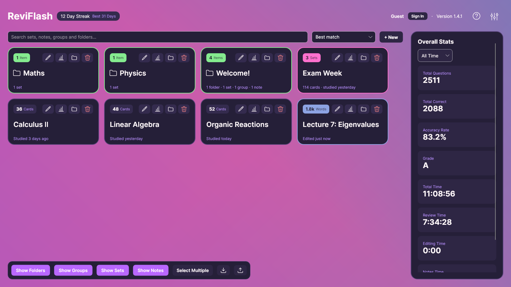
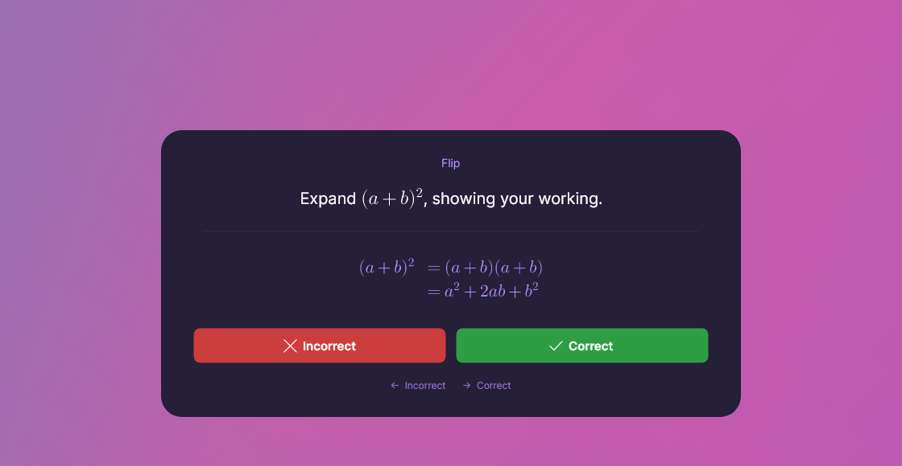
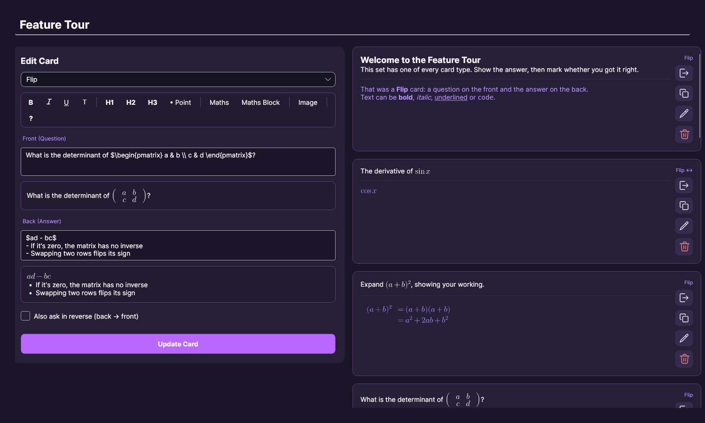
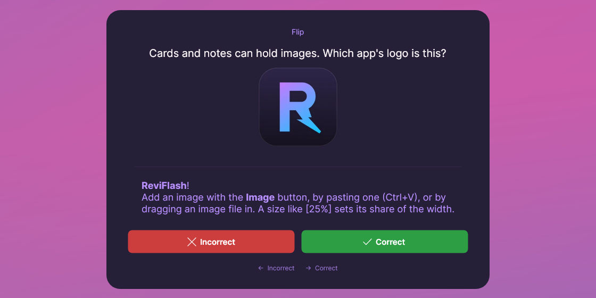
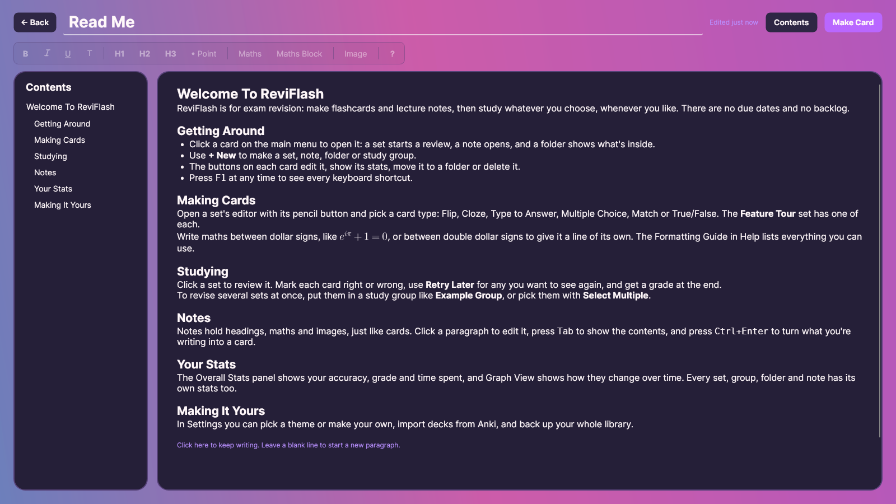
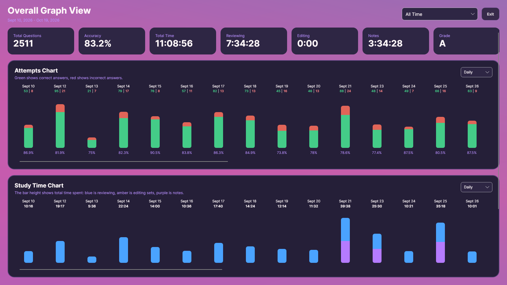
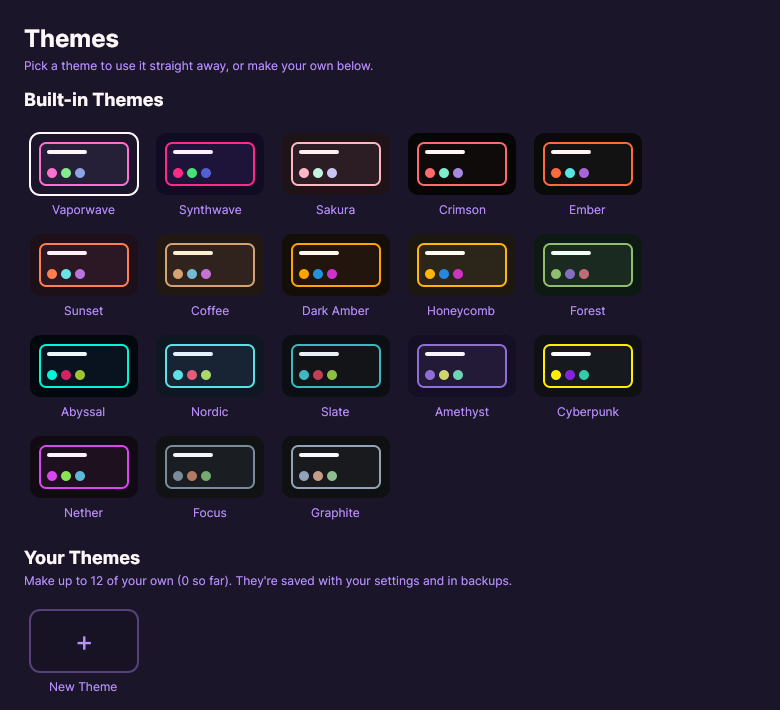

# ReviFlash

**ReviFlash doesn't think for you.** It's a free, open-source flashcard and lecture notes app for exam revision in maths, science, engineering and computer science. You write your own cards, because writing them is half the revision, and you choose what to study and when. There are no due cards, no backlog and no AI deciding for you, just the run-up to your exam on your terms.

Maths renders properly, inline with your text: fractions, integrals, matrices and aligned working, in your cards and your notes alike.



[See everything ReviFlash can do ↓](#features)

**Coming from Anki?** Import your `.apkg` decks straight in. Formatting, MathJax and `[latex]` maths, images, cloze deletions, type-in answers and reversed cards all come across, and sub-decks become folders.

Spaced-repetition apps like Anki are built for remembering things over months. ReviFlash is built for the run-up to an exam: drill a topic now, see your grade for it, and come back to the cards you got wrong.

## Download ReviFlash
Get the latest release for your platform from the [GitHub Releases Page](https://github.com/IsaacHoneyman/ReviFlash/releases/latest):

| Platform | Download Link | Notes |
| :--- | :--- | :--- |
| **Windows** | [📥 **ReviFlash-win-Setup.exe**](https://github.com/IsaacHoneyman/ReviFlash/releases/latest) | Automated installer & updater |
| **Windows (portable)** | [📥 **ReviFlash-win-Portable.zip**](https://github.com/IsaacHoneyman/ReviFlash/releases/latest) | No installer, unzip and run |
| **macOS (Apple Silicon)** | [📥 **ReviFlash-osx-Setup.pkg**](https://github.com/IsaacHoneyman/ReviFlash/releases/latest) | Installer & updater, see the note below |
| **macOS (portable)** | [📥 **ReviFlash-osx-Portable.zip**](https://github.com/IsaacHoneyman/ReviFlash/releases/latest) | No installer, unzip and run |
| **Linux** | [📥 **ReviFlash.AppImage**](https://github.com/IsaacHoneyman/ReviFlash/releases/latest) | Standalone file |

> **Linux Users Note:** After downloading the `.AppImage`, make it executable before running:
> ```bash
> chmod +x ReviFlash.AppImage
> ./ReviFlash.AppImage
> ```

> **macOS Users Note:** ReviFlash isn't signed with a paid Apple Developer account, so the first time you open it macOS will say it can't be verified. Close that message, then go to **System Settings → Privacy & Security**, scroll down and click **Open Anyway**. You only need to do this once. If macOS instead says the app is damaged, run this in Terminal and open it again:
> ```bash
> xattr -dr com.apple.quarantine /Applications/ReviFlash.app
> ```

## Updates
Updates are handled automatically within ReviFlash! On startup the app checks whether a new version has been released and offers to update, showing the download progress before restarting into the new version. You can also check at any time from **Settings → Updates**, or turn the startup check off there.

## New in 1.4.1

A clean-up release: everything looks and works the same way in every window, and themes are now yours to make.

**Themes**
- A new **Themes** window, opened from Settings, shows every theme as a tile drawn in its own colours, listed round the colour wheel.
- **Make your own:** pick a background and two accents and ReviFlash works out the rest, keeping text and badges readable. Change any single colour if you want, name it, and keep up to 12. They're saved in your backups.
- Seventeen themes were retired, including the light themes. If you were using one, ReviFlash switches to Vaporwave.

**A cleaner main menu**
- Every card has the same kind of line under its name: when a set was last studied, a group's cards, a folder's contents, or a note's last edit.
- Notes have their own colour, and their badge shows the word count.
- Badges are readable on every theme and say "1 Card", "1 Set" and "1 Item".

**New installs**
- ReviFlash starts with a **Welcome!** folder: a Feature Tour with one of every card type, an example set and study group, and a Read Me on how to use the app.

**Clearer messages**
- When something goes wrong, like an upload, backup or update check, a message pops up with the whole explanation instead of a cut-off line in the corner.
- Confirmations and errors have a short title, like "Delete Set?", with the details underneath.
- Success messages show briefly and then fade.

**Everywhere else**
- Every button, checkbox and toggle shows a clear highlight when you reach it with Tab or the arrow keys.
- One consistent set of text sizes, colours and capitalisation across every window, and the app says "set" everywhere.
- Community and the Cloud Manager switch between sets and notes with a sliding switch.
- Delete All Stats now clears notes time and your launch streak too.
- Typed answers ignore extra spaces, and grades always match the percentage shown.
- Images and display maths no longer get extra blank lines around them.
- Over 20 more fixes, from stale Community results to deleted folders lingering in stats.

## Features

### Maths that renders properly
Write LaTeX between `$...$` in a line of text, or `$$...$$` on its own line: fractions, sums, integrals, limits, matrices, `cases` and aligned working all render, in the editor's live preview, in reviews and in notes. A built-in Formatting Guide lists everything you can use, with examples.



### Six card types, written by you
- **Flip**: a question and an answer, optionally asked both ways round.
- **Cloze**: hide parts of a sentence or formula. Each blank becomes its own question, blanks with the same number are hidden together, and you can choose to type the answer.
- **Type to Answer**: type the answer and ReviFlash checks it, ignoring case and extra spaces.
- **Multiple Choice**: one or more correct options.
- **Match**: pair up items from two columns.
- **True/False**: with your own labels if you like, such as "Closed" and "Not closed".

The set editor has a formatting toolbar (bold, italic, underline, code, headings, bullet points, maths and images) and a live preview under every field. Move or copy cards between sets, or start a new card from an existing one.



### Images in cards and notes
Paste an image with Ctrl+V, drag one in, or use the Image button. Size it with a percentage of the width, and hide one inside a cloze blank until the answer is shown. Images are kept in your backups, and come across when you import from Anki.



### Lecture notes next to your cards
Write notes with headings, maths and images. A contents panel lets you jump around long notes, and Ctrl+Enter turns what you're writing into a card in any set. ReviFlash tracks your time spent on notes alongside your reviews.



### Study your way
- There are no due cards and no backlog: study any set, folder or study group whenever you like.
- Put sets from different topics into a **study group**, or pick several with **Select Multiple**, to review them together.
- Use **Retry Later** to bring back the cards you got wrong, and finish with a grade for the session.
- Organise everything into folders, and search your whole library from the main menu.
- New installs start with a **Welcome!** folder: a tour of every card type and a Read Me on how to use the app.

### Stats for everything
Every set, group, folder and note has its own stats: questions answered, accuracy, a grade, and time spent reviewing, editing and reading notes. Graph View shows how they change over time, with a year-long study calendar and a breakdown of where your time went.



### Share and sync online (optional)
With a free account you can:
- Upload sets and notes as **public** or **private**, then update, download or delete them from any device. Private uploads are an easy way to move your work between computers.
- Browse and search **Community** for other people's public sets and notes, and download them straight into your library, folders and all.

Everything is protected by Row-Level Security, and nothing is uploaded unless you upload it. Sets and notes with images can't be uploaded yet.

### Anki import and backups
- **Anki import**: bring in `.apkg` decks with their formatting, MathJax and `[latex]` maths, images, clozes, type-in answers and reversed cards. Sub-decks become folders.
- **Backups**: create and restore a full backup of your library, notes, images, settings and themes, with or without your stats.

### Themes, or make your own
Choose from 18 built-in themes, or make up to 12 of your own from a background and two accents. ReviFlash works out the rest and keeps text readable, and you can change any single colour if you want. An optional animated background swirl follows your theme.



### Keyboard-driven
Answer, mark, skip and retry cards without touching the mouse. On the main menu, the arrow keys move between cards and single keys edit, move, show stats for or delete them. Press **F1** anywhere for the full list of shortcuts.

## Tech Stack

- C# / .NET 10
- Avalonia UI (Cross-platform Desktop Framework)
- SQLite (`Microsoft.Data.Sqlite`) for local storage
- CSharpMath for formula rendering, with Latin Modern fonts
- SkiaSharp for images (stored as WebP)
- ZstdSharp for reading newer Anki packages
- Supabase (Database, Authentication & Storage, via its REST API)
- AWS (Cloud Infrastructure, hosting Supabase)
- Resend (Email Delivery Services)
- Velopack & GitHub Releases (For automatic updates)

## Contributing

Bug reports, feature requests, and pull requests are welcome. Please keep changes small and focused.

## Notes

- This project is primarily a local-first application; your sets, notes and study progress are stored locally in an SQLite database. Online features are strictly opt-in and need an account; nothing is uploaded unless you upload it.
- The app has over 480 unit tests, which run on Windows, macOS and Linux. Contributions are welcome.
